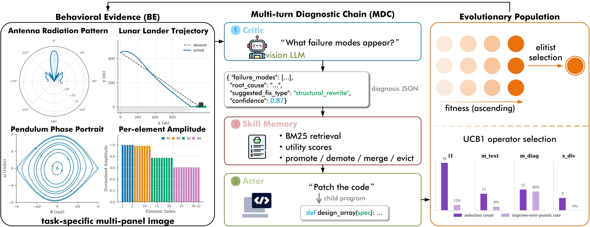

<div align="center">

# 🪞 REFLEX

### Reflective Evolution from LLM Experience

**Train-free multimodal evolutionary search for interpretable programmatic policies**

*See the failure, diagnose it, reuse what worked — and trace every step.*

[](https://arxiv.org/abs/2606.16496)
[](#-citation)
[](https://www.python.org/)
[](LICENSE)
[](#-why-reflex)
[](#-quick-start)
[](https://github.com/wangpan-ustc/REFLEX)

[🚀 **Quick Start**](#-quick-start) •
[🧠 **How It Works**](#-how-it-works) •
[📊 **Results**](#-results) •
[🧪 **Experiments**](#-running-the-experiments) •
[📖 **Docs**](docs/architecture.md) •
[📝 **Citation**](#-citation)

</div>

---

## ✨ Why REFLEX?

In existing LLM-guided program evolution, a single multimodal call has to read
the visual evidence, diagnose the failure, *and* write the fix. When a mutation
fails, you cannot tell whether the model misread the evidence or wrote bad
code — and the reusable knowledge stays buried inside whole programs.
REFLEX splits that loop apart:

| | **What it does** |
|---|---|
| 👁️ **Vision Critic** | Reads rendered Behavioral Evidence (trajectories, phase portraits, radiation cuts) and emits a structured JSON diagnosis. |
| ✍️ **Text Actor** | Writes the child program from the diagnosis, the parent code, and retrieved skills — never from the raw image. |
| 🧩 **Skill Memory** | A persistent BM25-indexed bank of executable snippets. Each snippet is credited with the fitness change of the children that use it. |
| 🎰 **UCB1 operators** | A bounded-reward bandit chooses among diagnostic mutation, text mutation, crossover, cross-domain inspiration, and fresh proposals. |
| 🔍 **One auditable trace** | Evidence → diagnosis → retrieved skills → child → measured fitness, all logged per call. |

> **No parameters are updated.** Learning happens only in the population, the
> operator bandit, and the skill bank.

## 📊 Results

Headline numbers reported in the paper (10 paired seeds, matched backends):

**Classic control — median LLM calls to reach the solve threshold (100-call budget, lower is better)**

| Task | **REFLEX** | Actor-only | Official MLES |
|---|:---:|:---:|:---:|
| Acrobot | **13** | 28 | 41 |
| Pendulum | **20** | 46 | 53 |
| Lunar Lander | **24** | 43 | 49 |

**36-D antenna-array synthesis (CCAA)** — under an equal 240-evaluation budget
and shared initialization, REFLEX reaches the harder 25.25 score threshold on
**9/10** seeds, versus at most **3/10** for CMA-ES, GA, and PSO.

**Cross-task transfer** — frozen Skill Memory banks from Pendulum or Lunar
Lander raise the final Acrobot score on **10/10** paired seeds.

## 🧠 How It Works

<p align="center">
  
</p>

<p align="center"><em>
<b>Left:</b> each parent program is rendered as a task-specific multi-panel
Behavioral Evidence (BE) image. <b>Middle:</b> the Multi-turn Diagnostic Chain
— a vision Critic diagnoses the failure, Skill Memory retrieves reusable
snippets, and a text-only Actor patches the code. <b>Right:</b> children join
an elitist population, and a UCB1 bandit picks the next operator.
</em></p>

1. **Render.** The evaluator scores the parent and draws its Behavioral
   Evidence: trajectories, phase portraits, radiation patterns, per-element
   amplitudes.
2. **Diagnose.** The **Critic** (vision LLM) reads the BE image and returns a
   JSON diagnosis: failure modes, root cause, suggested fix type, and confidence.
3. **Retrieve.** The diagnosis becomes a BM25 query over **Skill Memory**, a
   bank of executable snippets ranked by their measured utility.
4. **Repair.** The text-only **Actor** writes the child program from the
   diagnosis, the parent code, and the retrieved skills.
5. **Credit.** The child–parent fitness change updates each used skill's
   utility (improving children are distilled into new skills; persistently
   harmful skills are archived) and rewards the operator in the UCB1 bandit.

See [docs/architecture.md](docs/architecture.md) for the full design.

## 🚀 Quick Start

### Install

```bash
git clone https://github.com/wangpan-ustc/REFLEX.git && cd REFLEX
python3 -m venv .venv && source .venv/bin/activate
python -m pip install --upgrade pip setuptools wheel
python -m pip install -e ".[dev,control]"     # Acrobot, Pendulum

# Lunar Lander additionally needs Box2D
python -m pip install swig
python -m pip install --no-build-isolation -e ".[gym]"
```

### Configure an LLM endpoint

Any OpenAI-compatible endpoint works. Use a vision-capable model for the Critic.

```bash
export LLM_HOST="https://api.example.com/v1"   # placeholder
export LLM_MODEL="your-vision-model"           # placeholder
read -s LLM_KEY && export LLM_KEY
# Optional: separate vision endpoint via VISION_HOST / VISION_KEY / VISION_MODEL
```

### Run your first campaign

```bash
python examples/run_acrobot.py \
  --vision-model "$LLM_MODEL" \
  --budget 50 \
  --llm-call-budget 50 \
  --run-to-call-budget \
  --reproducible-evaluation \
  --log-dir runs/acrobot_demo \
  --skill-bank runs/acrobot_demo/skill_bank.json
```

The run writes `history.json` (every candidate, LLM-call trace, UCB1 and
Skill Memory statistics) and `best_policy.py` to `--log-dir`.

## 🧪 Running the Experiments

### Tasks

| Runner | Task | Objective | Extra |
|---|---|---|---|
| [`examples/run_acrobot.py`](examples/run_acrobot.py) | Acrobot-v1 | Solve-time score, distance penalty if unsolved (target −0.20) | `control` |
| [`examples/run_pendulum.py`](examples/run_pendulum.py) | Pendulum-v1 | Stable-upright final-state score | `control` |
| [`examples/run_lander.py`](examples/run_lander.py) | LunarLander-v3 | Normalized weighted score (reward, fuel, success) | `gym` |
| [`examples/run_antenna.py`](examples/run_antenna.py) | CCAA synthesis | Sidelobe level, directivity, and beamwidth score | — |

Run any runner with `--help` for all options. Score definitions and budget
conventions are documented in [docs/experiments.md](docs/experiments.md).

### Seeds and reproducibility

- Runs draw a random campaign seed and random environment seeds by default.
  The values used are printed at start-up and stored as `seed` and
  `training_seeds` in `history.json`.
- Re-run on the same environments with `--seed <seed> --training-seeds <s1,s2,...>`.
  LLM sampling itself remains stochastic.
- Constant polishing is disabled by default (`--polish-mode none`); pass
  `--polish-mode cem` to enable numeric constant refinement.

The paper's control comparisons used population 16, a 4,096-token output cap,
one sampling worker, and campaign seeds 0–9, e.g.:

```bash
for seed in $(seq 0 9); do
  python examples/run_acrobot.py \
    --vision-model "$LLM_MODEL" --max-tokens 4096 --pop-size 16 \
    --budget 100 --llm-call-budget 100 --run-to-call-budget \
    --reproducible-evaluation --seed "$seed" \
    --log-dir "runs/acrobot_reflex/seed_$seed" \
    --skill-bank "runs/acrobot_reflex/seed_$seed/skill_bank.json"
done
# Actor-only ablation: add --diagnostic-mode actor_only
```

### CCAA equal-budget comparison

Every script seeds each run with its run identifier
(`np.random.default_rng(run_id)`), so REFLEX and every baseline with the same
`run_id` start from the same random vector.

<details open>
<summary><b>1. CPU-only classical baselines</b> (Random Search, CMA-ES, GA, PSO — no API needed)</summary>

```bash
python scripts/ccaa/run_ccaa_classical_baselines.py \
  --out-root runs/ccaa_classical --budget 240 --num-runs 10 --workers 8
```
</details>

<details open>
<summary><b>2. Freeze one first-LLM prior per run</b></summary>

Uses `LLM_KEY`, or prompts for it without echo.

```bash
python scripts/ccaa/generate_ccaa_priors.py \
  --llm-host "$LLM_HOST" --llm-model "$LLM_MODEL" \
  --out-root runs/ccaa_llm_priors_strict36
```
</details>

<details open>
<summary><b>3. Classical baselines from the shared LLM prior</b></summary>

```bash
python scripts/ccaa/run_ccaa_classical_baselines.py \
  --out-root runs/ccaa_classical_llm_prior \
  --prior-root runs/ccaa_llm_priors_strict36 \
  --initializations shared_llm_first_prior --budget 240
```
</details>

<details open>
<summary><b>4. Strict REFLEX run</b></summary>

```bash
python scripts/ccaa/run_ccaa_reflex_formal.py \
  --llm-host "$LLM_HOST" --llm-model "$LLM_MODEL" \
  --prior-root runs/ccaa_llm_priors_strict36 \
  --out-root runs/ccaa_reflex_formal --budget 240 --run-workers 2
```

The strict runner evaluates deterministic 36-D array designs under a 1-to-1
candidate evaluation budget.
</details>

## 📁 Repository Layout

```text
reflex/          Core framework: Critic/Actor, operators, UCB1, Skill Memory, LLM client
examples/        Task runners, evaluators, and Behavioral Evidence renderers
scripts/ccaa/    CCAA baselines, frozen priors, and strict REFLEX runner
tests/           Offline tests (local fixtures and simulators, no API calls)
docs/            Architecture and experiment notes
third_party/     MLES policy templates with their original license
```

## ✅ Tests

```bash
python -m pytest -q
ruff check .
```

The full suite needs the `gym` extra and makes no model requests.

## 🔒 Security

REFLEX **executes model-generated Python**. Run task runners inside a
container or OS sandbox. See [SECURITY.md](SECURITY.md).

## 📝 Citation

If you find REFLEX useful, please cite:

```bibtex
@article{wang2026reflex,
  title={REFLEX: Reflective Evolution from LLM Experience},
  author={Wang, Pan},
  journal={arXiv preprint arXiv:2606.16496},
  year={2026}
}
```

## 🙏 Acknowledgements

The Acrobot, Pendulum, and Lunar Lander policy templates are copied unchanged
from the official MLES implementation (commit `acda6457`; see
[third_party/mles_templates](third_party/mles_templates/README.md)) and keep their
[original MIT license](third_party/mles_templates/LICENSE).

## 📄 License

REFLEX is released under the [MIT License](LICENSE). Contributions are welcome —
see [CONTRIBUTING.md](CONTRIBUTING.md) and [CHANGELOG.md](CHANGELOG.md).
